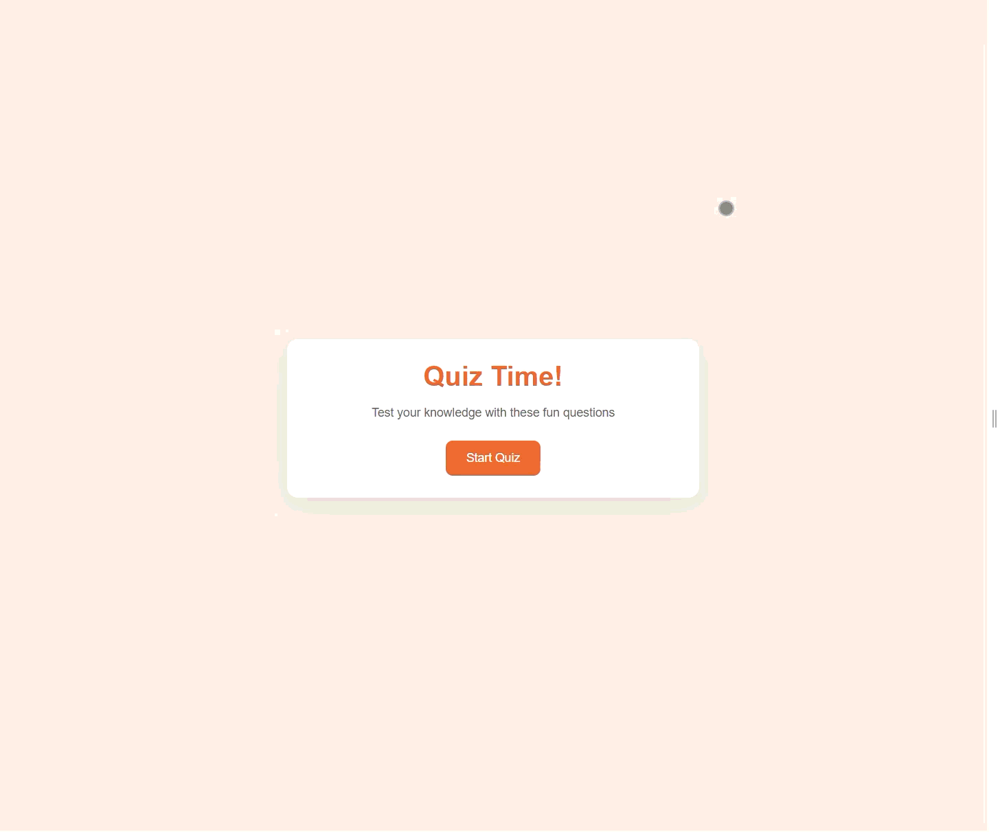

# Quiz Game

A simple 5 question quiz with multiple choices and a single answer. The app keeps track of the user's current score and progress. Project 1 of [100 Days of HTML, CSS and JavaScript](https://www.udemy.com/course/100-html-css-js/?src=sac&kw=100+days+of) course from Burak Orkmez.

## Key Features

- 5 multiple choice questions and answers, with correct and incorrect answers highlighted upon guess
- Keep track of the user's score and progress with a dynamic progress bar
- Easily add new questions and answers to the JS file
- Fully responsive and cross-compatible with all major browsers

## My Additions

- Coming soon...

## Demo

## Tech Stack

- HTML
- CSS
- JavaScript

## Getting Started

This project does not use any packages, so it can be viewed straight from your browser of choice.